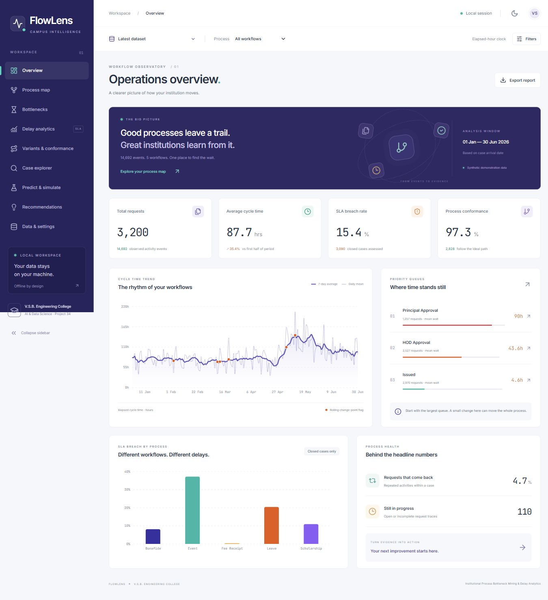

# FlowLens — Campus Process Intelligence

**Institutional Process Bottleneck Mining & Delay Analytics**  
Project 34 · Artificial Intelligence and Data Science · V.S.B. Engineering College, Karur

Team: Muthukarthigai Selvam S (922524243079), Kavin Sarvesh R (922524243117).

A complete offline mini project that reconstructs institutional approval workflows from event logs. Discover queues, inspect request timelines, compare actual and ideal paths, investigate SLA breaches, predict early-stage risk and simulate improvements. Every screen uses the FastAPI backend; there are no hardcoded dashboard metrics or external analytics APIs.

## Quick start — Windows

Install Python 3.11+ and Node.js 22.12+ (or 24 LTS). Open PowerShell **inside this project directory**, then:

```powershell
py -3 run.py setup
py -3 run.py demo
```

The first command installs dependencies (internet required once). The second creates the sample CSV, loads SQLite, starts both services and opens your browser. Afterwards, normal operation is offline. Keep the terminal open; press **Ctrl+C** to stop both services.

On macOS/Linux use `python3` instead of `py -3`. The Makefile offers the requested commands:

```sh
make setup
make seed
make run
# or make demo to seed, start and open the browser
make test
make build
```

Windows does not require Make. `py -3 run.py seed`, `run`, `test`, `build` are exact equivalents. All paths are resolved relative to the project, so it can be moved or extracted anywhere.

UI: **http://127.0.0.1:5173** · API: **http://127.0.0.1:8000** · interactive API docs: **http://127.0.0.1:8000/docs**.

## Screenshots



Additional tested views: [dark overview](docs/screenshots/overview-dark.jpg), [process map](docs/screenshots/process-map.jpg), [mobile overview](docs/screenshots/overview-mobile.jpg). An exported [sample report](docs/sample-report.pdf) is included.

## Nine connected workspaces

| Workspace | Working features |
| --- | --- |
| Overview | Cohort KPIs, real cycle trend, ranked queues, breach by process, rework and open cases |
| Process map | React Flow DFG, severity edges, frequency slider, zoom/fit, mini map, ideal-path overlay, node/edge detail drawers |
| Bottlenecks | Activity/edge/role/resource rankings, adjustable weighted scores, distributions, box summaries and resource service comparison |
| Delay analytics | Compliance gauge, percentiles, weekday/hour heatmap, rolling change flags, queue snapshots, utilisation proxy, lift and chi-square associations |
| Variants & conformance | Exact traces, happy paths, alignment fitness, skipped/extra/out-of-order steps, deviation filter |
| Case explorer | Search, pagination, detailed Gantt timelines separating elapsed queue and service, SLA deadline |
| Predict & simulate | Early-stage random forest, chronological metrics and baseline, feature importance, probability form, 0–100% queue-reduction scenarios |
| Recommendations | Impact-ranked interventions, evidence, effort, 30/50% reduction results, PDF export |
| Data & settings | Drag/drop CSV, row audit, built-in sample, dataset switching, SLA/activity targets, holiday calendar, weights, ideal sequences, pseudonyms |

Shared controls include dataset, process, department and arrival-date filters; collapsible navigation; persistent light/dark preference; loading, empty and error states; CSV/PDF exports. Fonts and assets are bundled locally, with no CDN dependency.

## Input format

UTF-8 CSV, maximum 25 MB / 100,000 event rows. `resource` is optional; other headers are required. Dates accept ISO or `YYYY-MM-DD HH:MM` strings. Timezone-aware strings are normalised to UTC; naive strings are treated as the institution's local clock. Do not mix timezone conventions within one file.

```csv
case_id,process_type,activity,start_time,end_time,role,department,resource,outcome
FEE-001,Fee Receipt,Submission,2026-06-01 09:00,2026-06-01 09:15,Student,AI & DS,Student,Approved
FEE-001,Fee Receipt,Office Processing,2026-06-01 11:00,2026-06-01 12:00,Office,AI & DS,Office Clerk A,Approved
FEE-001,Fee Receipt,Issued,2026-06-01 12:30,2026-06-01 12:40,Office,AI & DS,Office Clerk A,Approved
```

Outcome values: `Approved`, `Rejected`, `Returned`. A case closes at the final activity in its configured ideal sequence, or on a final `Rejected` outcome, provided all event end times are present. Unconfigured workflows use `Issued` as the fallback terminal activity. Missing end times and truncated traces remain open. This explicit terminal convention is necessary because the input does not include a case-status field.

Custom uploaded workflow, department and activity names appear automatically in the selectors and settings editors. Configure each new workflow's SLA and ideal sequence in **Data & settings**. Until an ideal sequence is saved, its conformance is **not assessed** and it is excluded from aggregate fitness. Unconfigured SLA targets default to 120 hours and activity queue targets to 24 hours; the editor shows these defaults explicitly.

Validation removes exact duplicate events; rejects malformed dates, reversed intervals, missing required metadata, unsupported outcomes and conflicting process/department labels within a case. It retains missing end times as open intervals and warns about overlaps. An import with some invalid rows still creates a dataset from accepted rows; inspect its receipt before using its results. Rejected rows cannot be reconstructed.

## Algorithms and interpretation

See [algorithms](docs/algorithms.md) for formulas, examples, complexity and assumptions. Waiting time is a gap **between** activities; service is the observed interval **within** an activity. With the calendar toggle, only queue gaps are converted to 09–17 Monday–Saturday business hours. Adjusted cycle = elapsed cycle − excluded queue hours. Service stays elapsed. SLA targets are expressed in the currently selected clock and should be adjusted by the institution when switching clocks.

Arrival-date filters preserve complete traces; they do not cut off activities after the selected end date. Open cases are excluded from SLA rates and model training. Rejected closed cases remain eligible. Queue charts are exact counts at daily noon snapshots, not daily averages. Utilisation is an observed busy-time proxy, not measured staffing capacity. Lift/chi-square tables show exploratory associations, not causal effects. What-if scenarios subtract queue time without modelling downstream feedback or signing-day rescheduling.

## Data and reproducibility

`backend/app/seed/sample_events.csv` has 3,200 cases and 14,724 rows (14,692 after 32 duplicate removals), with arrivals January–June 2026. A total of 110 cases contain missing ends, including deliberate data glitches. `ground_truth.json` describes five injected patterns. Seed 34 fixes all random choices. The ground-truth test independently measures the observed effects and requires at least four detections.

Reference results with default elapsed-hour settings:

- 87.7 h mean closed-case cycle; 15.4% breach rate; 97.3% alignment fitness.
- Principal Approval 90.0 h mean queue; HOD Approval 43.6 h.
- 50% Principal queue reduction: 69.6 h mean cycle, 7.8% breach, 235 breaches avoided.
- Random forest: 81.1% accuracy, 50.0% precision, 65.0% recall on 618 later test cases. Majority baseline accuracy is also 81.1%; do not claim accuracy improvement over that baseline. Class-balanced training emphasises breach recall. Probabilities are uncalibrated and intended for demonstration.

These are synthetic experiment results, not findings about actual college staff.

## Verification

```powershell
py -3 run.py test
py -3 run.py build
cd frontend
npm run lint
```

Backend tests use their own temporary SQLite database. See [verification](docs/verification.md) for measured results, performance and browser checks. HTML service-coverage evidence is included in `docs/coverage/index.html`.

## Manual developer launch

After setup, open two terminals:

```powershell
# terminal 1, from project root
cd backend
..\.venv\Scripts\python.exe -m uvicorn app.main:app --host 127.0.0.1 --port 8000
```

```powershell
# terminal 2, from project root
cd frontend
npm run dev
```

Vite proxies `/api` to 8000. SQLite is created in `backend/flowlens.db` by default. Copy `backend/.env.example` to `backend/.env` to change the database URL or allowed local origins. Configuration is loaded with python-dotenv. API filters are documented at `/docs`. `GET /api/analysis` provides a shared dashboard snapshot; the individual endpoints in the brief are also implemented.

## Troubleshooting

- **Python opens the Store:** use `py -3` after installing official Python, or pass its full executable path.
- **npm is blocked in PowerShell:** use `npm.cmd`; the launcher already does this on Windows.
- **Port already occupied:** stop the previous FlowLens terminal with Ctrl+C. The launcher refuses to kill unrelated processes.
- **No data / blank cohort:** load sample data in Data & settings, then clear process/department/date filters. A department filter matches its exact uploaded name.
- **CSV rejected:** use UTF-8 and the download template; inspect row reasons in the quality receipt.
- **Prediction unavailable:** supply at least 50 closed cases with two activities, both SLA classes, and a training period containing both classes.
- **Different numbers after edits:** saved SLA rules/calendar/weights invalidate caches immediately. Restore defaults if comparing against the reference figures above.
- **Moving between computers:** extract source and rerun setup. Virtual environments and `node_modules` are intentionally excluded from the portable archive.

This is a local single-user academic system. It has no authentication or internet deployment configuration. Keep the API bound to loopback. Display pseudonyms do not encrypt the SQLite database.

## Project documents

[Architecture](docs/architecture.md) · [Algorithms](docs/algorithms.md) · [30 viva questions](docs/viva_qna.md) · [Report outline](docs/report_outline.md) · [Five-minute demo](docs/demo_script.md)
