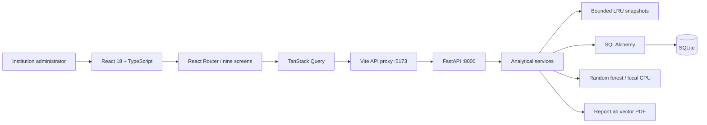
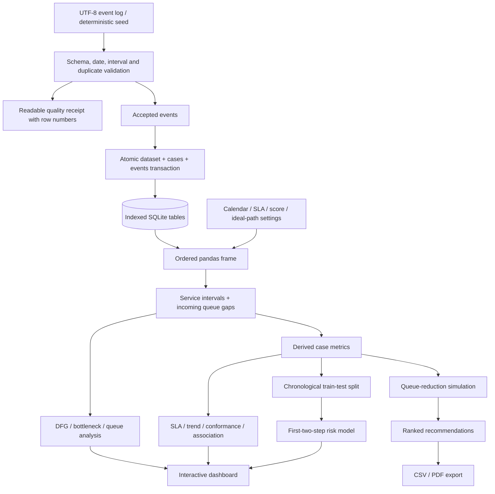

# Architecture

FlowLens is an offline, single-user analytical application. The browser communicates only with a loopback FastAPI service. No paid API, remote database, CDN font or external inference service is needed after installation.

## Persistence

| Table | Purpose and keys |
| --- | --- |
| datasets | Name, import time and complete quality receipt; integer primary key |
| cases | Dataset-local case IDs; unique `(dataset_id, case_id)`; baseline status and SLA snapshot |
| events | Ordered activity intervals; indexes on dataset, case, process, activity, department and start time |
| sla_rules | Saved per-process SLA and activity targets |
| analysis_cache | Persisted institution settings; computed frames use bounded in-memory LRU caches |

Event rows are the source of truth. Case aggregates are recalculated from events whenever a settings/filter cache key changes; stored baseline case flags are not reused after SLA edits. Resource pseudonyms are applied to a copy before downstream analytics. The raw database remains unchanged.

## Request lifecycle

1. Select the requested dataset (or the most recent dataset if unspecified).
2. Apply process/department filters and select complete cases by arrival date.
3. Use a snapshot key containing dataset, filters and serialised settings.
4. On a cache miss, derive all shared metrics once; on a hit, reuse tables.
5. Train ML on demand for the entire dataset with a separate four-entry model cache.
6. Return only JSON-ready summaries; paginate case registers and fetch timelines individually.

Raw frames are bounded to four datasets; shared snapshots to twelve filter combinations. Uploads and saved settings invalidate dependent caches. There is no disk analytics cache that can silently return stale SLA metrics.

## Frontend organisation

- `src/api.tsx`: typed transport, query hooks, filter state, settings and notifications.
- `src/components`: shared chart, loading, error, export, metric and panel components.
- `src/pages`: analytical views, React Flow map, prediction/simulation and settings.
- `src/types.ts`: explicit API interfaces; no TypeScript `any` escape hatches.
- `src/styles.css`: custom design tokens, responsive breakpoints, dark mode, reduced motion and locally bundled fonts.

## Deliberate boundaries

No multi-tenant authentication, approval execution, staff monitoring agent or automated disciplinary decisions. The app reads event logs and supplies analytical evidence. SQLite is appropriate for this academic, local workload; concurrent enterprise usage would require a server database, authentication, task queue and stronger access controls. The application is bound to `127.0.0.1` by its launch scripts.
